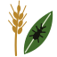
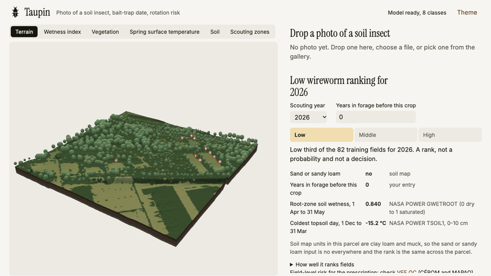
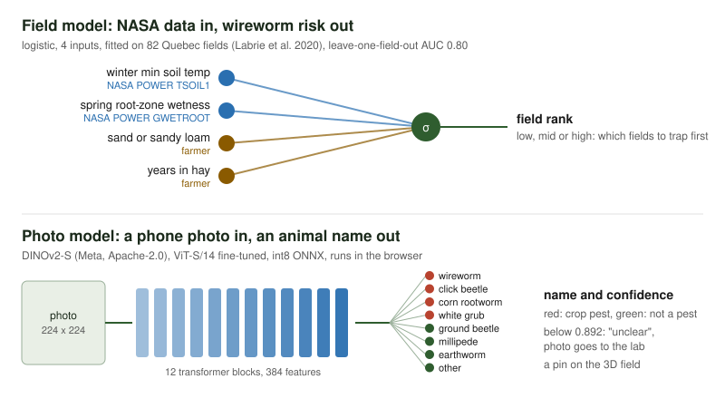
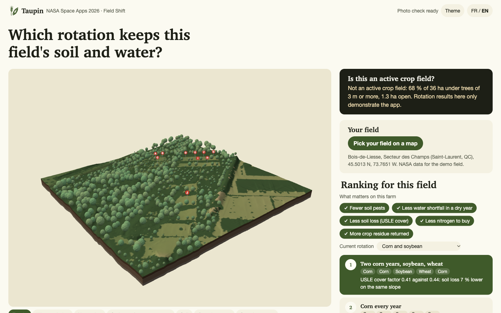
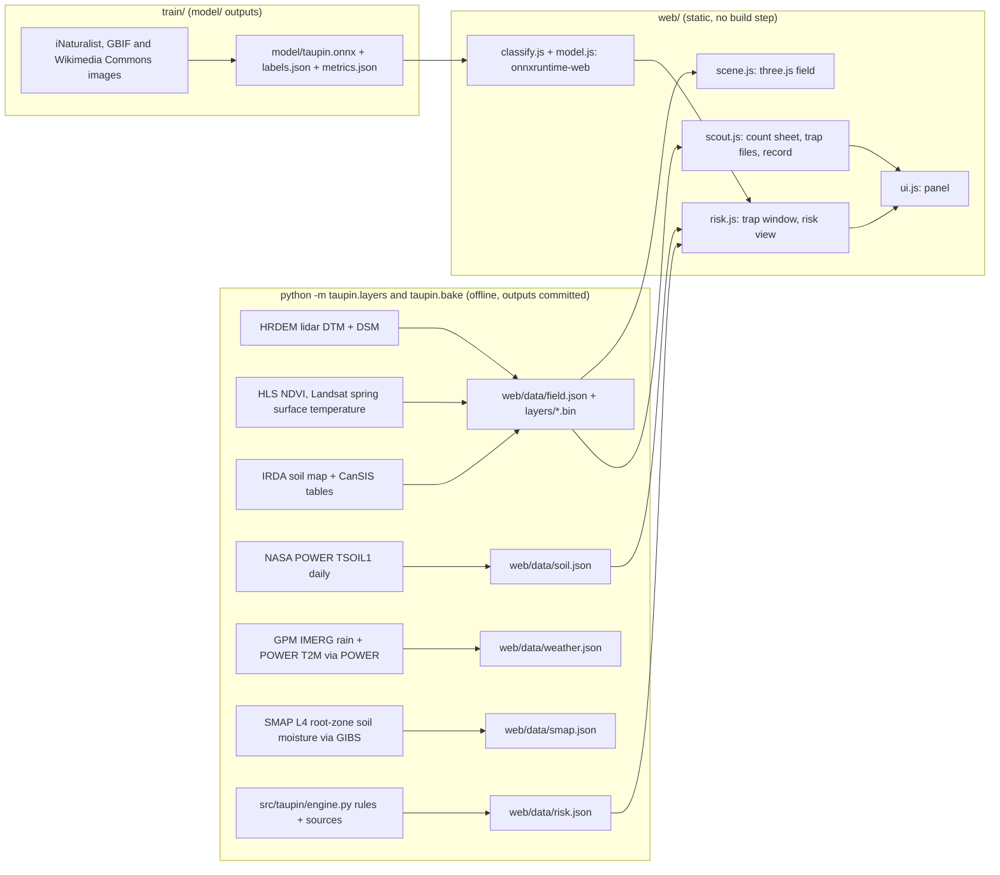

[English](README.md) · Français

<p align="center"></p>

# Taupin

Taupin aide un producteur de grains du Canada ou des États-Unis et son agronome à dépister les vers
fil-de-fer dans un champ avant d'acheter des semences enrobées d'insecticide. Il date la semaine de
pose des pièges-appâts à partir de la température du sol de NASA POWER, place les pièges sur un champ
en 3D construit à partir du lidar, de NASA HLS, de Landsat et de la carte des sols, enregistre les
dénombrements, nomme un insecte du sol à partir d'une photo, et compare sept rotations de cultures sur
cinq ans pour l'eau, la perte de sol, l'azote, les résidus de culture et les ravageurs, avec la pluie
NASA GPM et l'humidité du sol SMAP. Il fonctionne dans le navigateur, hors ligne ; les photos et les
dénombrements ne quittent jamais l'appareil.

Conçu pour NASA Space Apps 2026. Taupin est le nom français du coléoptère taupin et de sa larve, le
ver fil-de-fer.

Application : https://nas01010101.github.io/taupin/ (anglais, français avec `?lang=fr`). Vidéo de
démonstration, 30 s :
[`docs/assets/demo-30s.mp4`](docs/assets/demo-30s.mp4) ; une version de 46 s avec le modèle de photo : [`docs/assets/demo-46s.mp4`](docs/assets/demo-46s.mp4).

<p align="center">


</p>



## Données d'entrée

- **Entrée principale : données satellitaires et de la NASA.** La pluie GPM IMERG, l'humidité du sol SMAP L4, HLS (NASA Landsat et ESA Sentinel-2) et la
  végétation et la température de surface Landsat, la carte des cultures d'AAC (classée à partir de Sentinel-2, de Landsat et du radar RADARSAT Constellation de l'ASC), et la température du sol de NASA POWER (MERRA-2) alimentent les couches
  du champ en 3D, le modèle de risque du champ (logistique, 4 variables, ajusté sur 82 champs du Québec de Labrie et al.
  2020, AUC en validation croisée par champ exclu 0,80) et les scores de rotation.
- **Entrée complémentaire : photos prises au téléphone.** Le modèle de photo est DINOv2-S (Meta, Apache-2.0) avec une tête à 8 classes,
  exécuté dans le navigateur en ONNX int8. Une photo devient une épingle datée sur le champ en 3D ; elle teinte le sol
  autour de l'épingle et repondère les scores de rotation. En dessous de 0,892 de confiance, la réponse est « incertain »
  et la photo est destinée au laboratoire.

## Couverture : Amérique du Nord

NASA POWER et GPM IMERG couvrent tous les points de l'Amérique du Nord. La semaine de piégeage, le rang du champ et
les colonnes d'eau des rotations fonctionnent donc pour n'importe quelles coordonnées saisies par le producteur ou pour l'une des six régions agricoles
de la première page. Le tableau est `web/data/regions.json`, produit par `node scripts/regions.mjs` avec
le code qu'exécute la page (2026-11-15).

| Région | Lat., long. | Semaine de piégeage (sol à 12 °C) | Rang du champ (année) | Variables d'entrée hors de la plage d'entraînement du Québec | Pluie GPM, mm par an, 2001 à 2025 |
|---|---|---|---|---|---|
| Montérégie, Québec | 45,63 ; -72,96 | 15 mai | bas (2026) | aucune | 824 à 1 334 |
| Chatham-Kent, Ontario | 42,4 ; -82,18 | 29 avr. | bas (2026) | aucune | 738 à 1 387 |
| Île-du-Prince-Édouard | 46,35 ; -63,3 | 29 mai | bas (2026) | aucune | 865 à 1 515 |
| Saskatoon, Saskatchewan | 52,13 ; -106,67 | 19 mai | élevé (2026) | gwet_spring | 207 à 724 |
| Comté de Story, Iowa | 42,03 ; -93,62 | 22 avr. | élevé (2026) | gwet_spring | 645 à 1 317 |
| Magic Valley, Idaho | 42,56 ; -114,46 | 8 mai | bas (2026) | gwet_spring, tsoil_winter_min_c | 148 à 472 |

Le rang du champ a été ajusté sur des champs du Québec ; lorsqu'une variable d'entrée sort de cette plage, la page le
signale et le rang est une extrapolation. Le terrain en 3D (lidar de RNCan) et la carte des sols correspondent à un seul champ du Québec.

Prochaines étapes : des dénombrements de pièges de l'Ontario, des Prairies et des États-Unis pour réajuster le rang par région, le lidar USGS 3DEP
pour les champs américains, l'humidité du sol de RADARSAT Constellation de l'Agence spatiale canadienne (ASC) comme couche directe, puis tout pays disposant de dénombrements de
pièges, de cartes des sols et de terrain.

## Deux publics

Une seule base de code, deux versions qui partagent les règles NASA, le modèle de photo et le champ en 3D :

- **Producteurs et agronomes : l'application Web** (`web/`). La première page compte six étapes : votre champ,
  semaine de piégeage, où piéger, saisir les dénombrements, photo, quoi semer. Les chiffres des modèles se trouvent sous « Détails »
  au bas de la page.
- **Chercheurs : [`docs/RESEARCH.md`](docs/RESEARCH.md)**, le plan d'un article : question, méthodes,
  résultats actuels tirés de `risk/model/metrics.json` et `model/metrics.json`, limites, évaluations
  comparatives prévues et revues possibles.

Comment Taupin répond au défi et à ses critères d'évaluation : [`docs/CHALLENGE_FIT.md`](docs/CHALLENGE_FIT.md).

## Fonctions

- **Pourquoi.** Depuis le 1er août 2025 au Québec, les semences enrobées d'insecticide (classe 3A) exigent la prescription
  d'un agronome (Code de gestion des pesticides, D. 470-2025). La preuve pour un champ est un
  dénombrement au piège-appât. Dans Labrie et al. 2020, 92,6 % de 68 champs de maïs sont restés sous 1 ver fil-de-fer par piège.
- **Quand piéger.** Les pièges-appâts se posent lorsque les 10 premiers cm du sol atteignent 12 °C. D'après NASA POWER
  `TSOIL1`, de 1995 à 2025 : le 14 mai en moyenne, le 8 mai en 2025. Le panneau des pièges donne un calendrier selon la méthode
  du RAP : pièges prêts à la date hâtive (6 mai, 1 année sur 10), posés à 12 °C, souvent au
  semis, trois relevés à une semaine d'intervalle, et le dénombrement décide des semences de la saison suivante.
- **Où piéger.** Un carré de 600 m tracé à partir du relief et du couvert végétal du lidar à 1 m, de la végétation NASA HLS,
  de la température de surface printanière Landsat et de la carte des sols. Dix points de piégeage, espacés d'environ 25 m, sont
  répartis dans quatre zones de dépistage définies à partir de ces couches. Les zones ne constituent pas une carte de risque.
- **Quels champs en premier.** Un modèle ajusté sur 82 champs du Québec piégés au piège-appât classe un champ dans le tiers bas,
  moyen ou élevé pour une année donnée, à partir de deux réponses du formulaire de champ et de deux valeurs de NASA POWER. Le
  résultat est un rang, pas une probabilité.
- **Votre propre champ.** Entrez une latitude et une longitude, ou utilisez la position de l'appareil. La page demande à
  NASA POWER la température du sol et l'humidité de la zone racinaire à ce point et affiche la date de piégeage, la
  date de chaque année depuis 1995 et le rang du champ. Seules les deux coordonnées quittent l'appareil,
  et la réponse est conservée pour une utilisation hors réseau. La page demande aussi la pluie quotidienne NASA GPM IMERG et la
  température de l'air, de sorte que les colonnes d'eau du tableau des rotations sont celles du champ. Le champ en 3D, les points de
  piégeage et les niveaux de ravageurs restent ceux du champ affiché : le carré de démonstration, ou l'un des trois
  champs agricoles préparés d'avance, dont les niveaux de ravageurs partent de leur propre historique de cultures.
- **Dénombrer.** Une feuille pour trois relevés par piège. Chaque relevé est comparé séparément au seuil
  de l'espèce dominante (3 par piège pour *Hypnoidus abbreviatus*, 1 pour *Agriotes*, *Limonius*
  et *Melanotus* ; RAP Grandes cultures, Agri-Réseau doc. 115269).
- **Identifier.** Déposez une photo ; un modèle à 8 classes (DINOv2-S, ONNX, exécuté avec onnxruntime-web) nomme
  l'animal et l'épingle sur le champ. En dessous de son seuil d'abstention, il répond « incertain » et indique
  comment envoyer la photo au laboratoire de diagnostic en phytoprotection du MAPAQ. Taupin n'envoie rien.
- **Consigner les observations.** Une fois la photo nommée, « Enregistrer où je l'ai trouvé » lit la position de l'appareil, ou le GPS
  de la photo si vous le choisissez, seulement à ce clic. Les observations restent dans le navigateur, apparaissent comme épingles sur le
  champ lorsqu'elles tombent dans le carré de démonstration, vont dans le dossier de l'agronome et s'exportent en CSV et
  en GeoJSON. La dernière observation remplit les coordonnées de « Votre champ ». « Supprimer toutes les observations » les efface.
- **Planifier.** Sept rotations pour 2026 à 2030 : maïs chaque année, maïs et soya (indiquée comme rotation actuelle;
  le producteur peut en indiquer une autre), maïs-soya-blé, maïs-sarrasin-soya-blé, sarrasin d'abord
  (maïs en année 3, pour un champ qui sort du foin), soya-blé sans maïs, et deux années de maïs
  suivies de soya et de blé. Chacune reçoit
  le déficit hydrique en année sèche (pluie GPM IMERG comparée au besoin en eau des cultures selon FAO-56), les jours de forte pluie sur sol
  nu, le facteur de couverture de l'USLE pour le travail du sol choisi (OMAFRA 23-005), l'azote à acheter (CRAAQ, MAPAQ),
  les résidus de culture retournés au sol (Lal 2005) et les niveaux de ver fil-de-fer et de chrysomèle des racines du maïs. Le producteur coche ce qui
  compte pour lui et les rotations sont classées selon ces critères. Chaque carte de rotation indique pourquoi elle est proposée, les
  preuves, les gains et les pertes par rapport à la rotation actuelle, les données manquantes et les risques. Une
  valeur sans source s'affiche comme ? et n'est jamais comptée comme zéro.
- **Votre propre rotation.** Sous « Construire votre propre rotation », le producteur choisit une culture pour chaque année, parmi
  les cultures dont les valeurs sont sourcées dans `web/data/crops.json` (une culture ajoutée à ce fichier devient sélectionnable),
  et ajoute jusqu'à trois rotations, conservées dans le navigateur seulement. Elles s'ajoutent au tableau, aux cartes et au
  choix de « rotation actuelle ». Leurs niveaux de ravageurs viennent de `web/js/engine.js`, un portage ligne par ligne de
  `src/taupin/engine.py` qui lit les constantes de règles dans `risk.json` ; `web/test/engine.test.mjs`
  le compare à chaque préréglage de `risk.json`, à chaque séquence de 5 ans des quatre cultures et à 80
  cas tirés au hasard avec traces (`python -m taupin.engine_parity` écrit le fichier de référence). Le texte de leurs cartes est
  rédigé à partir des règles du moteur qui se sont appliquées, chacune avec sa source. Elles partent du même historique de cultures
  que les préréglages : celui du champ lui-même pour un champ agricole préparé d'avance, trois années de prairie pour le parc.
- **Votre historique de cultures.** Sous la bande des cultures, « Vérifier votre historique de cultures » affiche 2021 à 2025, prérempli
  à partir de la carte satellitaire des cultures pour un champ agricole préparé d'avance (avec sa part des cellules ouvertes) et vide
  ailleurs, ainsi que la dernière année de foin ou de pâturage si elle est antérieure. Une année modifiée par le producteur, ou une dernière année
  de foin, devient le point de départ du moteur : chaque rotation, préréglages compris, est alors évaluée dans le
  navigateur à partir de ces années (`web/js/history.js`, `web/js/engine.js`). À Laval, du soya en 2025 au lieu
  de maïs fait passer la chrysomèle des racines du maïs de 2026 de ÉLEVÉ à FAIBLE. Le dossier de l'agronome énumère chaque année avec sa
  source (carte satellitaire, confirmée, ou saisie par le producteur). Conservé dans le navigateur seulement, par champ.
  `web/test/history.test.mjs` vérifie aussi que le tableau préparé d'avance de chaque ferme est égal au résultat du moteur du navigateur.
- **Remettre.** Les points de piégeage en GPX, CSV et GeoJSON, et un dossier en texte avec la date de piégeage, les
  dénombrements, le classement et les photos, pour l'agronome. Taupin ne décide jamais de la prescription.
  L'agronome signe.

## Travaux existants

VFF QC (CÉROM et MAPAQ, https://cerom.qc.ca/vffqc/) donne déjà un niveau de risque de ver fil-de-fer par champ,
à partir d'un modèle ajusté sur près de 800 champs du Québec. Le modèle de Taupin compte 82 champs et n'est pas un
meilleur prédicteur. Taupin ajoute la semaine de piégeage, les données d'entrée NASA, les points de piégeage dans le champ, la feuille de
dénombrement, le modèle de photo ainsi que le code et les données ouverts. `docs/PROJECT.md` contient la comparaison et les
lacunes restantes.

## Lancer l'application

Dans le navigateur : https://nas01010101.github.io/taupin/ (construite à partir de `web/` et `model/` par
`.github/workflows/pages.yml` à chaque envoi vers `main`).

En local :

Nécessite Python 3.9 ou plus récent (bibliothèque standard seulement) et un navigateur. Aucune étape d'installation, aucun réseau
après le premier chargement. Les extras `classify` et `bake` nécessitent Python 3.11 ou plus récent.

| Système | Commande |
|---|---|
| macOS | double-clic sur `run.command`, ou `./run.command` |
| Windows | double-clic sur `run.bat` |
| Linux | `./run.sh` |
| Tous, avec uv | `uv run python -m taupin` |

Le serveur écoute sur 127.0.0.1 à partir du port 8780 (premier port libre) et ouvre le navigateur.
`--demo` ouvre la séquence de démonstration scénarisée de 12 s (`?demo=1`) ; `--port N` choisit le port. L'application s'installe aussi
comme PWA et continue de fonctionner hors ligne une fois chargée.

Classer des photos en ligne de commande :

```bash
uv run --extra classify taupin classify photo1.jpg photo2.jpg
```

Taupin est une application Web statique servie par la bibliothèque standard de Python. Il n'y a pas de version Electron ou Tauri :
un onglet de navigateur remplit le même rôle sans téléchargement.

## Comment il est construit



Un autre champ est préparé avec `python -m taupin.fetch_layers --work <dir> --lat <lat> --lon <lon> --way
<osm way> --hrdem-id <project>`, puis `python -m taupin.layers --work <dir> --irda <dir> --cansis <dir>
--out web/data/fields/<id> --name <name>`. Le champ s'ouvre ensuite avec `?field=<id>` une fois inscrit dans `web/data/fields/index.json`.

- `src/taupin/` : moteur de risque, fenêtre de piégeage à partir de la température du sol POWER, couches de champ, préparation, serveur
  local, classificateur en ligne de commande.
- `risk/` : le modèle de risque du champ : dénombrements numérisés, variables NASA POWER, ajustement et métriques.
- `web/` : l'application. `three` 0.187.0, `onnxruntime-web` 1.31.1 et les polices sont fournis dans
  `web/vendor/` (versions dans `web/vendor/VERSIONS.md`).
- `train/`, `model/`, `data/` : entraînement du classificateur, modèle exporté et attribution de ses images.
- `scripts/capture.mjs` pilote Chrome sans interface pour les captures d'écran et les images de démonstration;
  `scripts/make_gif.py` transforme les images en `docs/assets/demo.gif`.

Prévisions (`web/js/forecast.js`) : la semaine de piégeage, l'éclosion de la chrysomèle des racines du maïs et les colonnes d'eau des rotations
pour les cinq prochaines saisons viennent de quatre modèles ajustés sur l'historique annuel du champ (moyenne de toutes les
années, moyenne des 10 dernières, tendance linéaire, moyenne des deux). Chacun est évalué par un test rétrospectif
à origine glissante (ajustement sur les années jusqu'à t, prédiction de t + 1 à t + 5), l'erreur la plus faible
l'emporte, et l'intervalle à 80 % va du 10e au 90e centile des écarts de ce modèle lors de son propre test rétrospectif. Sur
le champ de démonstration (POWER TSOIL1 1995-2025), la moyenne l'emporte : écart de date de piégeage de 6,9 jours contre 8,4 pour la
tendance, éclosion de la chrysomèle 3,8 contre 4,2. L'intervalle provient des mêmes écarts que ceux qui ont servi à choisir le modèle,
il est donc aussi vérifié sur des écarts qui n'ont pas servi à le construire (`rangeCheck` : chaque écart comparé à l'intervalle
établi à partir des précédents) : sur le champ de démonstration, l'intervalle de la date de piégeage a tenu 61 fois sur 70 (87 %).
Aucune prévision météorologique n'est utilisée.

Tests : `uv run pytest` (moteur, sol, préparation, parité du classificateur, serveur, vérifications Web) et
`node --test web/test/*.test.mjs` (prétraitement, softmax, abstention, vue du risque, rendus). Le
prétraitement du navigateur correspond au classificateur Python sur des entrées de référence.

## Modèle

Tiré de `model/metrics.json` (version `v2-dinov2s`, DINOv2-S ajusté, 8 classes, 23 Mo en
ONNX int8). En dessous d'une probabilité top-1 de 0,892 après mise à l'échelle de la température, l'application répond « incertain : à envoyer
au laboratoire ». « Réponses données » est la part des photos au-dessus de ce seuil.

| Jeu | Photos | Exactitude | F1 macro | Réponses données | Exactitude des réponses données |
|---|---|---|---|---|---|
| Validation | 976 | 94,6 % | 0,946 | 90,0 % | 98,1 % |
| Test (scellé) | 756 | 92,5 % | 0,931 | 84,9 % | 97,5 % |
| Autres sources (GBIF 334, Wikimedia Commons 157) | 491 | 92,7 % | 0,926 | 85,3 % | 97,4 % |

La version précédente (`v1-effb0`) obtient 86,1 % sur les mêmes photos de test et 86,2 % sur les mêmes
photos d'autres sources.

Limites, telles que mesurées :

- Le jeu d'autres sources a été vérifié à l'œil par une seule personne : 157 images sur 648 ont été retirées (coléoptères
  adultes classés comme larves, planches, dessins, photos sans animal net). Avant la vérification, le
  modèle obtenait 76,5 % sur les 648. La liste se trouve dans `data/ood_audit.csv`.
- Le modèle a quand même répondu pour 92 de ces 157 images retirées au lieu de les envoyer au laboratoire. Une
  photo sans animal du sol peut recevoir un nom avec confiance.
- Le seuil correspond à la cible de 98 % en validation. Il a été choisi après que les cibles de 95 % et de 98 % ont
  toutes deux été évaluées sur le test et sur les autres sources ; il n'a donc pas été fixé d'avance.
- Il n'existe pas encore de jeu de test de photos prises dans des champs du Québec.

Le nombre d'images par classe, le tableau des seuils et la méthode de découpage sont dans `model/MODEL_CARD.md`.

## Données et licences

| Données | Usage | Licence |
|---|---|---|
| API de points quotidiens NASA POWER (MERRA-2) : `TSOIL1`, `GWETROOT` | date de piégeage ; deux variables du modèle de risque du champ | Données ouvertes de la NASA |
| Pluie quotidienne NASA GPM IMERG via NASA POWER (`IMERG_PRECTOT`), avec `T2M_MAX`, `T2M_MIN`, 2001 à 2025 | besoin en eau des rotations, pluie, jours de forte pluie sur sol nu | Données ouvertes de la NASA |
| Humidité de la zone racinaire analysée NASA SMAP L4 via GIBS, avril 2015 à septembre 2025 | vérification de l'humidité POWER ; graphique d'humidité du sol | Données ouvertes de la NASA |
| NASA HLS v2.0 (L30 de Landsat 8/9, S30 de ESA Copernicus Sentinel-2), 23 scènes d'été sans nuages, 2020 à 2025 | couche de végétation (NDVI) | Données ouvertes de la NASA |
| USGS Landsat 8/9 Collection 2 Level-2, 46 scènes d'avril et de mai sans nuages, 2016 à 2025 | couche de température de surface printanière | domaine public |
| Lidar HRDEM de RNCan, 1 m, 2023 | relief, hauteur du couvert végétal, pente, indice d'humidité topographique | Licence du gouvernement ouvert - Canada |
| Carte des sols de l'IRDA (1:20 000) et tableaux CanSIS d'AAC | unités de sol et leur texture | voir `DATA_SOURCES.md` |
| OpenStreetMap, way 542903996 | contour du parc | ODbL |
| Labrie et al. 2020, PLoS ONE 15(2): e0229136 | dénombrements au piège-appât du modèle de risque du champ | CC BY 4.0 |
| Photos iNaturalist, GBIF et Wikimedia Commons | entraînement et test du classificateur | CC0, CC-BY ou domaine public, par image dans `data/attribution.csv` |
| RAP Grandes cultures, Agri-Réseau doc. 115269 | méthode et seuils du piège-appât | citée |
| MAPAQ, Laboratoire d'expertise et de diagnostic en phytoprotection | marche à suivre pour les photos incertaines et identification des espèces | citée |
| MAPAQ / RAP, Agri-Réseau doc. 118135 | règles pour la chrysomèle des racines du maïs | citée |
| Saguez et al. 2017, doi:10.1093/ee/nvx116 ; Noronha et al. 2023, doi:10.1007/s11829-023-09982-9 | facteurs liés au ver fil-de-fer | citée |
| Code de gestion des pesticides, D. 470-2025 | règle de prescription | citée |
| FAO-56 (Allen et al. 1998) ; OMAFRA Factsheet 23-005 ; grilles d'azote du CRAAQ et du MAPAQ ; Lal 2005 ; rendements de Concertation Grains Québec | besoin en eau des cultures, facteur de couverture de l'USLE, azote, résidus (`web/data/crops.json`) | citée |

`DATA_SOURCES.md` énumère chaque couche avec sa source, sa licence, sa résolution native et sa date d'accès.

Les poids du modèle partent de `timm/vit_small_patch14_dinov2.lvd142m` (Meta DINOv2, Apache-2.0).
Code : MIT (`LICENSE`). Polices : Instrument Serif et Inter, OFL-1.1.

Photos de la galerie (Wikimedia Commons) :

| Photo | Auteur | Licence |
|---|---|---|
| [Ver fil-de-fer (larve d'Elateridae)](https://commons.wikimedia.org/wiki/File:Click_beetle_larvae.jpg) | ZATRIPPIT | CC0 |
| [Taupin (adulte d'Agriotes)](https://commons.wikimedia.org/wiki/File:Wireworm_Click_Beetle_-_Agriotes_obscurus_%3F_(51859491891).jpg) | gailhampshire | CC BY 2.0 |
| [Chrysomèle occidentale des racines du maïs adulte](https://commons.wikimedia.org/wiki/File:Western_corn_rootworm.jpg) | inconnu | Domaine public |
| [Larves de chrysomèle des racines du maïs](https://commons.wikimedia.org/wiki/File:Diabrotica_virgifera_virgifera_larvae.jpg) | Scott Bauer, USDA ARS | CC BY 3.0 |
| [Carabe (Carabidae)](https://commons.wikimedia.org/wiki/File:Pterostichus_melanarius_321269585.jpg) | Alexandria 'Alex' Wenninger | CC BY 4.0 |
| [Ver blanc (larve de scarabée)](https://commons.wikimedia.org/wiki/File:Popillia_japonica_(28).jpg) | Michael Reding, USDA ARS, Bugwood.org | CC BY 3.0 US |

## Limites

- Le champ de démonstration est un carré de 600 m dans le Parc-nature du Bois-de-Liesse, secteur des Champs
  (45,5013 N, 73,7651 O), un parc de Montréal utilisé à la place d'un champ agricole. Seulement 1,3 ha y
  sont à découvert ; les prairies cartographiées ont repoussé d'environ la moitié depuis le lidar de 2023. Rien n'y est creusé,
  piégé ou prélevé.
- Le modèle de risque du champ compte 82 champs, dont 11 au seuil ou au-dessus. Ses quatre variables ont été choisies
  après la première validation croisée ; son AUC de 0,80 (IC à 95 % de 0,63 à 0,93) est donc optimiste ; une
  année entière mise de côté donne 0,68. Il classe les champs ; il ne donne pas de probabilité.
- Les zones de dépistage répartissent les pièges selon la variabilité du champ. Aucune source ne donne le risque de ver fil-de-fer
  à l'intérieur d'un champ, donc Taupin n'en montre aucun.
- Une photo est un premier tri, pas un dénombrement. Une photo qui ne montre aucun animal du sol peut quand même recevoir un
  nom avec confiance : 92 des 157 images retirées du jeu de test externe ont reçu une réponse au lieu de
  « incertain » (`model/MODEL_CARD.md`).
- Trois champs agricoles du Québec sont préparés en plus du parc (Laval, Saint-Eustache, Mirabel). Leur historique de
  cultures est l'Inventaire annuel des cultures d'AAC (AAFC Annual Crop Inventory) à 30 m : la culture de l'année est la classe majoritaire parmi les
  cellules ouvertes, donc une part voisine de 50 % indique un champ partagé. Cet historique fixe les années antérieures du tableau de ravageurs de chaque
  champ (`python -m taupin.bake --fields` écrit `web/data/fields/<id>/risk.json`) ; les
  zones de sol (matière organique 5 % et 12 %) restent le scénario du parc. La carte des sols de l'IRDA utilisée ne couvre que le feuillet 31H12,
  et le lidar HRDEM comporte des trous entre les projets (aucune couverture à Calumet).
- La matière organique du sol est le carbone organique de la couche de surface de chaque composante de sol CanSIS multiplié par
  1,724 (van Bemmelen), une valeur par unité de la carte des sols des années 1950 ; le vrai rapport peut atteindre environ 2,0, donc
  l'estimation est basse. SoilGrids 2.0 (250 m) est interrogé en direct comme seconde valeur et pour les champs
  hors de l'ensemble préparé ; il permet environ 5 appels par minute et peut expirer. Une analyse de laboratoire remplace les deux.
  Le moteur de ravageurs ne lit la matière organique qu'à travers le facteur du RAP « plus de 10 % ».
- Aucun producteur ni agronome n'a encore essayé l'outil.
- NASA POWER est une grille d'environ 50 km ; un champ peut devancer ou suivre de quelques jours les dates affichées.
- Ce n'est pas un produit de la NASA. Il utilise des données ouvertes de la NASA.

## Citer

```bibtex
@software{taupin2026,
  title = {Taupin: bait-trap dates, trap points, counts, photo triage and rotation risk for a Quebec field},
  author = {{Taupin contributors}},
  year  = {2026},
  url   = {https://github.com/Nas01010101/taupin},
  note  = {NASA Space Apps Challenge 2026}
}
```

Citez aussi les sources de données ci-dessus, en particulier NASA POWER, NASA HLS et Labrie et al. 2020.

## Sortie sur le terrain

Les photos de la sortie de l'équipe se trouvent dans [udem-ai-in-nature](udem-ai-in-nature/).

## Assistance par IA

Le code, les tests et la documentation ont été rédigés avec des assistants de programmation par IA et révisés par l'équipe.
