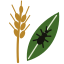
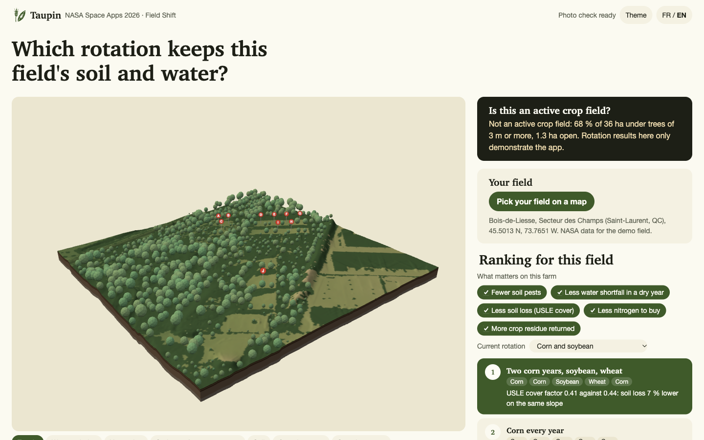

<p align="center"></p>

# Taupin

English · [Français](README.fr.md)

Taupin ranks five-year crop rotations for one field by soil, water and pests, from NASA data.
Pick a field anywhere on a map: the page builds it in 3D and scores seven rotations on NASA GPM
IMERG rain, NASA POWER soil temperature, SMAP soil moisture and HLS plant cover. The farmer's photos
and notes are an extra input pinned on the field. The farmer and the agronomist decide.

Built for NASA Space Apps 2026 (Field Shift: Adapting Farms with NASA Data). Quebec is the example
field. Taupin is French for wireworm and click beetle.

App: https://nas01010101.github.io/taupin/ (English; French with `?lang=fr`).
Demo video, 30 s: https://youtu.be/k4BG-ckcc1k, also in [`docs/assets/demo-30s.mp4`](docs/assets/demo-30s.mp4).



## What it does

- **Your field in 3D.** A tap on the map builds a 600 m square in the browser, in about 6 s: 1 m
  NRCan HRDEM lidar in Canada, AWS Terrain Tiles elsewhere, with plant cover, surface temperature,
  wetness index and SoilGrids organic matter layers. The field stays on the device and opens again
  with `?field=mine`.
- **Is this an active crop field?** Half or more of the square under canopy of 3 m or more means no.
- **Rotations ranked.** Seven rotations over five years, scored on dry-year water shortfall, soil
  loss (USLE cover), nitrogen to buy, residue returned and soil pests. The farmer ticks what matters
  and picks the current rotation; the cards re-rank and each one states its reason.
- **Photos and notes.** A photo or note (soil insect, standing water, ground cover, water channel) is
  pinned on the 3D field and changes the ranking. An 8-class photo model (DINOv2-S, int8 ONNX) runs in
  the browser and answers "unclear" below its threshold. Nothing leaves the device.

The video, scene by scene, with the code behind each part: [`docs/SYSTEM.md`](docs/SYSTEM.md).
How it fits the challenge: [`docs/CHALLENGE_FIT.md`](docs/CHALLENGE_FIT.md). Measured limits and
open work: [`docs/PROJECT.md`](docs/PROJECT.md).

## Run it

In the browser: https://nas01010101.github.io/taupin/ (deployed from `web/` and `model/` by
`.github/workflows/pages.yml` on each push to `main`).

Locally, with Python 3.9 or newer (standard library only) and a browser:

| OS | Command |
|---|---|
| macOS | double-click `run.command`, or `./run.command` |
| Windows | double-click `run.bat` |
| Linux | `./run.sh` |
| Any, with uv | `uv run python -m taupin` |

The server listens on 127.0.0.1 from port 8780 (first free port) and opens the browser.
`?field=demo` opens the park square from the video, `?field=laval`, `eustache` or `mirabel` a
Quebec farm field, `?demo=1` the scripted photo walk-through. The app works offline once loaded.

Classify photos on the command line (Python 3.11 or newer):

```bash
uv run --extra classify taupin classify photo1.jpg photo2.jpg
```

Tests: `node --test web/test/*.test.mjs` and `PYTHONPATH=src uv run --group dev python -m pytest`.

## Layout

- `web/`: the app, static, no build step. `three`, `onnxruntime-web` and `leaflet` are vendored in
  `web/vendor/` (versions in `web/vendor/VERSIONS.md`).
- `src/taupin/`: rotation and pest engine, NASA POWER, GPM IMERG and SMAP fetchers, field layers,
  bake, local server, CLI classifier.
- `risk/`: the field risk model (82 Quebec fields, NASA POWER features, fit and metrics).
- `train/`, `model/`, `data/`: photo model training, the exported model and image attribution.
- `scripts/capture.mjs`: headless Chrome screenshots and demo frames.

## Photo model

From `model/metrics.json` (`v2-dinov2s`, DINOv2-S fine-tuned, 8 classes, 23 MB int8 ONNX). Below a
top-1 probability of 0.892 the app answers "unclear: send to the lab".

| Split | Photos | Accuracy | Macro-F1 | Answered | Accuracy when answered |
|---|---|---|---|---|---|
| Validation | 976 | 94.6 % | 0.946 | 90.0 % | 98.1 % |
| Test (sealed) | 756 | 92.5 % | 0.931 | 84.9 % | 97.5 % |
| Other sources (GBIF 334, Wikimedia Commons 157) | 491 | 92.7 % | 0.926 | 85.3 % | 97.4 % |

Class counts, the threshold table and the split method are in `model/MODEL_CARD.md`.

## Data and licences

| Data | Use | Licence |
|---|---|---|
| NASA GPM IMERG daily rain via NASA POWER, with `T2M_MAX`, `T2M_MIN`, 2001 to 2025 | rotation water need, heavy-rain days on bare soil | NASA open data |
| NASA POWER (MERRA-2) `TSOIL1`, `GWETROOT` | soil temperature; field risk inputs | NASA open data |
| NASA SMAP L4 root-zone soil moisture via GIBS, 2015 to 2025 | check of the POWER wetness input | NASA open data |
| NASA HLS v2.0 (Landsat 8/9 and ESA Sentinel-2), 2020 to 2025 | plant cover layer (NDVI) | NASA open data |
| USGS Landsat 8/9 Collection 2 Level-2, 2016 to 2025 | spring surface temperature layer | public domain |
| NRCan HRDEM lidar, 1 m | relief, canopy height, slope, wetness index | Open Government Licence - Canada |
| AWS Terrain Tiles | terrain where there is no lidar | mixed open sources (tilezen/joerd attribution) |
| ISRIC SoilGrids 2.0, 250 m | organic matter for any field | CC BY 4.0 |
| AAFC Annual Crop Inventory | crop history in Canada | Open Government Licence - Canada |
| IRDA soil map and AAFC CanSIS tables | soil units for the Quebec fields | see `DATA_SOURCES.md` |
| OpenStreetMap | base map, park outline | ODbL |
| Labrie et al. 2020, PLoS ONE 15(2): e0229136 | field risk model counts | CC BY 4.0 |
| iNaturalist, GBIF and Wikimedia Commons photos | photo model training and test | CC0, CC-BY or public domain, per image in `data/attribution.csv` |
| FAO-56; OMAFRA Factsheet 23-005; CRAAQ and MAPAQ nitrogen grids; Lal 2005; RAP Grandes cultures | crop water need, USLE cover, nitrogen, residue, pest rules | cited |

`DATA_SOURCES.md` lists every layer with its source, licence, resolution and access date. Model
weights start from `timm/vit_small_patch14_dinov2.lvd142m` (Meta DINOv2, Apache-2.0). Code: MIT
(`LICENSE`).

Gallery photos (Wikimedia Commons):

| Photo | Author | Licence |
|---|---|---|
| [Wireworm (Elateridae larva)](https://commons.wikimedia.org/wiki/File:Click_beetle_larvae.jpg) | ZATRIPPIT | CC0 |
| [Click beetle (Agriotes adult)](https://commons.wikimedia.org/wiki/File:Wireworm_Click_Beetle_-_Agriotes_obscurus_%3F_(51859491891).jpg) | gailhampshire | CC BY 2.0 |
| [Western corn rootworm adult](https://commons.wikimedia.org/wiki/File:Western_corn_rootworm.jpg) | unknown | Public domain |
| [Corn rootworm larvae](https://commons.wikimedia.org/wiki/File:Diabrotica_virgifera_virgifera_larvae.jpg) | Scott Bauer, USDA ARS | CC BY 3.0 |
| [Ground beetle (Carabidae)](https://commons.wikimedia.org/wiki/File:Pterostichus_melanarius_321269585.jpg) | Alexandria 'Alex' Wenninger | CC BY 4.0 |
| [White grub (scarab larva)](https://commons.wikimedia.org/wiki/File:Popillia_japonica_(28).jpg) | Michael Reding, USDA ARS, Bugwood.org | CC BY 3.0 US |

## Limits

- The demo field is a 600 m square in the Parc-nature du Bois-de-Liesse (45.5013 N, 73.7651 W), a
  Montreal park used as a stand-in. The app itself says it is not an active crop field: 68 % of 36 ha
  is under trees, 1.3 ha is open.
- The field risk model has 82 fields; its leave-one-field-out AUC of 0.80 (95 % CI 0.63 to 0.93) is
  optimistic, and a held-out year gives 0.68. It ranks fields; it does not give a probability.
- A photo is a first sort, not a count. A photo with no soil animal can still get a confident name
  (`model/MODEL_CARD.md`). No test set of photos from Quebec fields exists yet.
- NASA POWER is a grid of about 50 km; a field can differ from the values shown.
- Lidar, the AAFC crop map and the IRDA soil map cover Canada only; elsewhere the field uses terrain
  tiles and SoilGrids, and crop history is entered by the farmer.
- No farmer or agronomist has tried the tool yet. Not a NASA product; uses NASA open data.

Photos from the team's field outing: [udem-ai-in-nature](udem-ai-in-nature/).

Code, tests and documentation were written with AI coding assistants and reviewed by the team.
