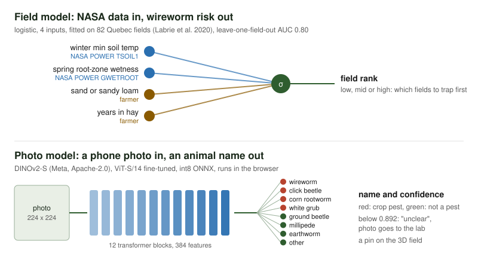
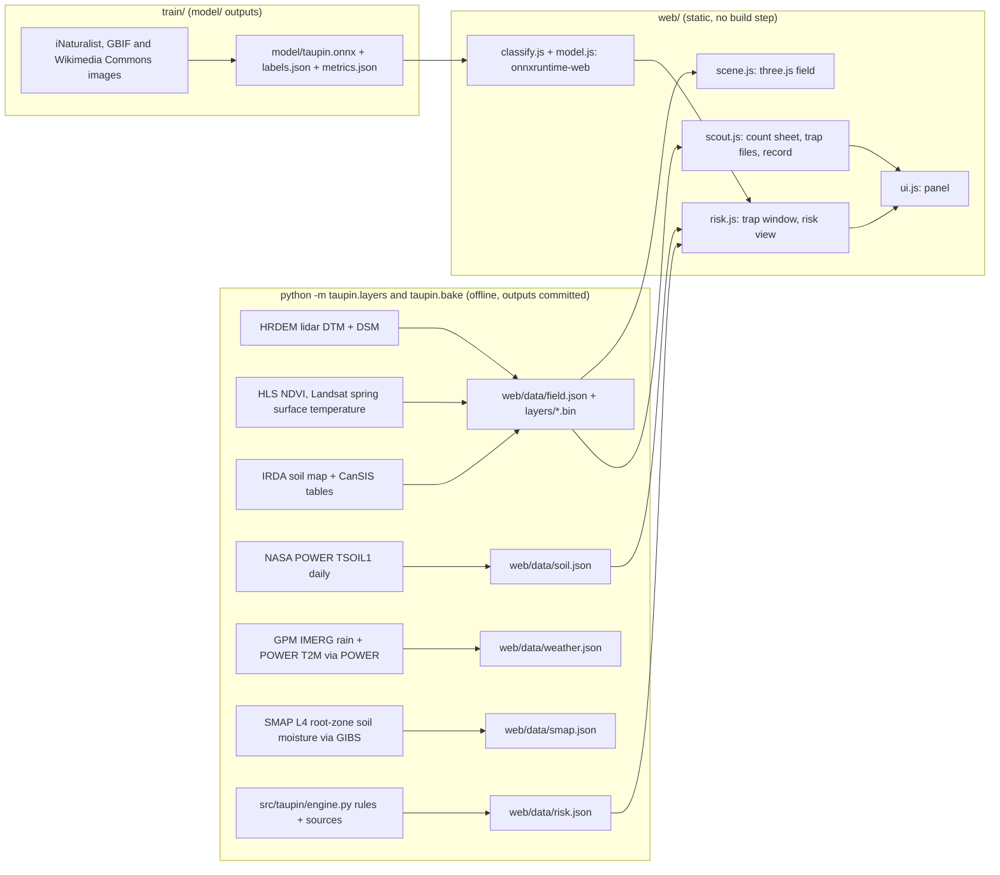

<p align="center"></p>

# Taupin

English · [Français](README.fr.md)

Taupin helps a grain farmer in Canada or the US and their agronomist scout a field for wireworms before buying
insecticide-coated seed. It dates the bait-trap week from NASA POWER soil temperature, places the
traps on a 3D field built from lidar, NASA HLS, Landsat and the soil map, takes the counts, names a
soil insect from a photo, and compares seven crop rotations over five years for water, soil loss,
nitrogen, crop residue and pests, with NASA GPM rain and SMAP soil moisture. It
runs in the browser, offline; photos and counts never leave the device.

Built for NASA Space Apps 2026. Taupin is French for wireworm and click beetle.

App: https://nas01010101.github.io/taupin/ (English, French with `?lang=fr`). Demo video, 30 s:
[`docs/assets/demo-30s.mp4`](docs/assets/demo-30s.mp4); a 46 s cut with the photo model: [`docs/assets/demo-46s.mp4`](docs/assets/demo-46s.mp4).

<p align="center">


</p>


## Inputs

- **Main input: satellite and NASA data.** GPM IMERG rain, SMAP L4 soil moisture, HLS (NASA Landsat and ESA Sentinel-2) and Landsat
  vegetation and surface temperature, the AAFC crop map (classified from Sentinel-2, Landsat and CSA RADARSAT Constellation radar), and NASA POWER (MERRA-2) soil temperature drive the 3D field
  layers, the field risk model (logistic, 4 inputs, fitted on 82 Quebec fields from Labrie et al.
  2020, leave-one-field-out AUC 0.80) and the rotation scores.
- **Extra input: phone photos.** The photo model is DINOv2-S (Meta, Apache-2.0) with an 8-class head,
  run in the browser as int8 ONNX. A photo becomes a dated pin on the 3D field; it tints the ground
  around the pin and reweights the rotation scores. Below 0.892 confidence the answer is "unclear"
  and the photo is meant for the lab.
- **Your own field, one tap.** "Pick your field on a map" opens OpenStreetMap with the AAFC crop map
  on top. A tap builds the 3D field for a 600 m square at that point, in the browser and in about
  6 s on a normal connection: NRCan HRDEM lidar (terrain and tree heights) is read straight from
  its cloud-optimized GeoTIFFs with HTTP range requests (about 2 MB, only the tiles needed), with
  AWS Terrain Tiles as a fallback where there is no lidar (outside Canada). Then come wetness
  index, scouting zones and 10 traps (JS ports of `terrain.py` and `zones.py`, checked against the
  Python output), plus 15 years of AAFC crop history over the field. The crop history sets the
  rotation, the forage years and the years since sod, so the pest table (a JS port of the
  engine, reproducing `risk.json` exactly) is computed for this field instead of assuming 3 years
  of sod. The field is kept on the device (about 210 kB) and opens with `?field=mine`.

## Coverage: North America

NASA POWER and GPM IMERG cover every point in North America, so the trap week, the field rank and
the rotation water columns run for any coordinates the farmer types or for one of six farm regions
on the first screen. The table is `web/data/regions.json`, made by `node scripts/regions.mjs` with
the code the page runs (2026-11-15).

| Region | Lat, lon | Trap week (soil at 12 °C) | Field rank (year) | Inputs outside the Quebec training range | GPM rain, mm a year, 2001 to 2025 |
|---|---|---|---|---|---|
| Montérégie, Quebec | 45.63, -72.96 | 15 May | low (2026) | none | 824 to 1,334 |
| Chatham-Kent, Ontario | 42.4, -82.18 | 29 Apr | low (2026) | none | 738 to 1,387 |
| Prince Edward Island | 46.35, -63.3 | 29 May | low (2026) | none | 865 to 1,515 |
| Saskatoon, Saskatchewan | 52.13, -106.67 | 19 May | high (2026) | gwet_spring | 207 to 724 |
| Story County, Iowa | 42.03, -93.62 | 22 Apr | high (2026) | gwet_spring | 645 to 1,317 |
| Magic Valley, Idaho | 42.56, -114.46 | 8 May | low (2026) | gwet_spring, tsoil_winter_min_c | 148 to 472 |

The field rank was fitted on Quebec fields; where an input falls outside that range the page says so
and the rank is an extrapolation. The 3D terrain (NRCan lidar) and the soil map are one Quebec field.

Next: trap counts from Ontario, the Prairies and the US to refit the rank per region, USGS 3DEP lidar
for US fields, Canadian Space Agency RADARSAT Constellation soil moisture as a direct layer, then any country with trap
counts, soil maps and terrain.

## Two audiences

One codebase, two versions that share the NASA rules, the photo model and the 3D field:

- **Farmers and agronomists: the web app** (`web/`). The first screen is six steps: your field,
  trap week, where to trap, enter counts, photo, what to plant. Model numbers sit under "Details"
  at the bottom of the page.
- **Researchers: [`docs/RESEARCH.md`](docs/RESEARCH.md)**, a paper outline: question, methods,
  current results from `risk/model/metrics.json` and `model/metrics.json`, limits, planned
  benchmarks and candidate venues.

How Taupin answers the challenge and its judging criteria: [`docs/CHALLENGE_FIT.md`](docs/CHALLENGE_FIT.md).

## What it does

- **Why.** Since 1 August 2025 in Quebec, insecticide-coated seed (class 3A) needs an agronomist's
  prescription (Code de gestion des pesticides, D. 470-2025). The evidence for one field is a
  bait-trap count. In Labrie et al. 2020, 92.6 % of 68 corn fields stayed under 1 wireworm per trap.
- **When to trap.** Bait traps go in when the top 10 cm of soil holds 12 °C. From NASA POWER
  `TSOIL1`, 1995 to 2025: 14 May on average, 8 May in 2025. The trap panel gives a calendar per
  RAP's method: traps ready by the early date (6 May in 1 year out of 10), set at 12 °C, often at
  seeding, three counts a week apart, and the count decides next season's seed.
- **Where to trap.** A 600 m square drawn from 1 m lidar relief and canopy, NASA HLS vegetation,
  Landsat spring surface temperature and the soil map. Ten trap points, about 25 m apart, are
  spread over four scouting zones of those layers. The zones are not a risk map.
- **Which fields first.** A model fitted on 82 Quebec bait-trapped fields ranks a field in the low,
  middle or high third for a year, from two field-form answers and two NASA POWER values. The
  output is a rank, not a probability.
- **Your own field.** Enter a latitude and longitude, or use the device's position. The page asks
  NASA POWER for soil temperature and root-zone wetness at that point and shows the trap date, the
  date for each year since 1995 and the field's rank. Only the two coordinates leave the device,
  and the answer is kept for use without a network. It also asks for daily NASA GPM IMERG rain and air
  temperature, so the water columns of the rotation table are the field's own. The 3D field, the trap
  points and the pest levels stay those of the field on screen: the demo square, or one of the three
  baked farm fields, whose pest levels start from their own crop history.
- **Count.** A sheet for three lifts per trap. Each lift is compared on its own with the threshold
  of the dominant species (3 per trap for *Hypnoidus abbreviatus*, 1 for *Agriotes*, *Limonius*
  and *Melanotus*; RAP Grandes cultures, Agri-Réseau doc. 115269).
- **Identify.** Drop a photo; an 8-class model (DINOv2-S, ONNX, run with onnxruntime-web) names
  the animal and pins it on the field. Below its abstain threshold it answers "unclear" and shows
  how to send the photo to the MAPAQ plant diagnostic lab. Taupin sends nothing.
- **Log finds.** After a photo is named, "Save where I found it" reads the device position, or the
  photo's GPS if you choose that, only on that tap. Finds stay in the browser, show as pins on the
  field when they fall in the demo square, go into the agronomist record and export as CSV and
  GeoJSON. The latest find fills in the coordinates for "Your field". "Delete all finds" clears them.
- **Plan.** Seven rotations for 2026 to 2030: corn every year, corn and soybean (marked as current;
  the farmer can mark another), corn-soybean-wheat, corn-buckwheat-soybean-wheat, buckwheat first
  (corn in year 3, for a field coming out of hay), soybean-wheat with no corn, and two corn years
  then soybean and wheat. Each gets the
  dry-year water shortfall (GPM IMERG rain against FAO-56 crop water need), heavy-rain days on bare
  soil, the USLE cover factor for the chosen tillage (OMAFRA 23-005), nitrogen to buy (CRAAQ, MAPAQ),
  crop residue returned (Lal 2005) and wireworm and corn rootworm levels. The farmer ticks what
  matters and the rotations are ranked on those. Each rotation card gives why it is there, the
  evidence, gains and losses against the current rotation, the information gaps and the risks. A
  value with no source shows as ? and is never counted as zero.
- **Your own rotation.** Under "Build your own rotation" the farmer picks a crop for each year, from
  the crops that have sourced values in `web/data/crops.json` (a crop added there becomes pickable),
  and adds up to three rotations, kept in the browser only. They join the table, the cards and the
  "current rotation" choice. Their pest levels come from `web/js/engine.js`, a line-for-line port of
  `src/taupin/engine.py` that reads the rule constants from `risk.json`; `web/test/engine.test.mjs`
  checks it against every preset of `risk.json`, every 5-year sequence of the four crops and 80
  seeded cases with traces (`python -m taupin.engine_parity` writes the fixture). Their card text is
  written from the engine rules that applied, each with its source. They start from the same crop
  history as the presets: the field's own on a baked farm field, three sod years on the park.
- **Your crop history.** Under the crop strip, "Check your crop history" shows 2021 to 2025, pre-filled
  from the satellite crop map on a baked farm field (with its share of the open cells) and empty
  elsewhere, plus the last hay or pasture year if it is earlier. A year the farmer changes, or a last
  hay year, becomes the engine's start: every rotation, presets included, is then scored in the
  browser from those years (`web/js/history.js`, `web/js/engine.js`). On Laval, 2025 soybean instead
  of corn takes 2026 corn rootworm from HIGH to LOW. The agronomist record lists each year with its
  source (satellite map, confirmed, or entered by the farmer). Kept in the browser only, per field.
  `web/test/history.test.mjs` also checks that each farm's baked table equals the browser engine.
- **Hand over.** Trap points as GPX, CSV and GeoJSON, and a text record with the trap date, the
  counts, the ranking and the photos, for the agronomist. Taupin never decides the prescription.
  The agronomist signs.

## Prior work

VFF QC (CÉROM and MAPAQ, https://cerom.qc.ca/vffqc/) already gives a wireworm risk level per field,
from a model fitted on close to 800 Quebec fields. Taupin's model has 82 fields and is not a
stronger predictor. Taupin adds the trap week, NASA inputs, trap points inside the field, the count
sheet, the photo model and open code and data. `docs/PROJECT.md` has the comparison and the open
gaps.

## Run it

In the browser: https://nas01010101.github.io/taupin/ (built from `web/` and `model/` by
`.github/workflows/pages.yml` on each push to `main`).

Locally:

Needs Python 3.9 or newer (standard library only) and a browser. No install step, no network
after the first load. The `classify` and `bake` extras need Python 3.11 or newer.

| OS | Command |
|---|---|
| macOS | double-click `run.command`, or `./run.command` |
| Windows | double-click `run.bat` |
| Linux | `./run.sh` |
| Any, with uv | `uv run python -m taupin` |

The server listens on 127.0.0.1 from port 8780 (first free port) and opens the browser.
`--demo` opens the scripted 12 s sequence (`?demo=1`); `--port N` picks the port. The app also
installs as a PWA and keeps working offline once loaded.

Classify photos on the command line:

```bash
uv run --extra classify taupin classify photo1.jpg photo2.jpg
```

Taupin is a static web app served by Python's standard library. There is no Electron or Tauri
build: a browser tab does the same job with no download.

## How it is built



Another field is baked with `python -m taupin.fetch_layers --work <dir> --lat <lat> --lon <lon> --way
<osm way> --hrdem-id <project>`, then `python -m taupin.layers --work <dir> --irda <dir> --cansis <dir>
--out web/data/fields/<id> --name <name>`. The field then opens with `?field=<id>` once listed in `web/data/fields/index.json`.

- `src/taupin/`: risk engine, POWER soil-temperature trap window, field layers, bake, local server,
  CLI classifier.
- `risk/`: the field risk model: digitized counts, NASA POWER features, fit and metrics.
- `web/`: the app. `three` 0.187.0, `onnxruntime-web` 1.31.1 and the fonts are vendored in
  `web/vendor/` (versions in `web/vendor/VERSIONS.md`).
- `train/`, `model/`, `data/`: classifier training, the exported model and its image attribution.
- `scripts/capture.mjs` drives headless Chrome for screenshots and demo frames;
  `scripts/make_gif.py` turns the frames into `docs/assets/demo.gif`.

Forecasts (`web/js/forecast.js`): the trap week, rootworm hatch and the rotation water columns
for the next five seasons come from four models fitted on the field's yearly history (mean of all
years, mean of the last 10, straight-line trend, average of the two). Each one is scored by a
rolling-origin backtest (fit on the years up to t, predict t + 1 to t + 5), the lowest error is
used, and the 80 % range is the 10th to 90th percentile of that model's own backtest misses. On
the demo field (POWER TSOIL1 1995-2025) the mean wins: trap date miss 6.9 days against 8.4 for the
trend, rootworm hatch 3.8 against 4.2. The range comes from the same misses that picked the model,
so it is also checked on misses it was not built from (`rangeCheck`: each miss against the range
made from the earlier ones): on the demo field the trap-date range held 61 of 70 times (87 %).
No weather forecast is used.

Tests: `uv run pytest` (engine, soil, bake, classifier parity, server, web checks) and
`node --test web/test/*.test.mjs` (preprocessing, softmax, abstain, risk view, renderers). The
browser preprocessing matches the Python classifier on golden inputs.

## Model

From `model/metrics.json` (version `v2-dinov2s`, DINOv2-S fine-tuned, 8 classes, 23 MB as int8
ONNX). Below a top-1 probability of 0.892 after temperature scaling the app answers "unclear: send
to the lab". "Answered" is the share of photos above that threshold.

| Split | Photos | Accuracy | Macro-F1 | Answered | Accuracy when answered |
|---|---|---|---|---|---|
| Validation | 976 | 94.6 % | 0.946 | 90.0 % | 98.1 % |
| Test (sealed) | 756 | 92.5 % | 0.931 | 84.9 % | 97.5 % |
| Other sources (GBIF 334, Wikimedia Commons 157) | 491 | 92.7 % | 0.926 | 85.3 % | 97.4 % |

The previous version (`v1-effb0`) scores 86.1 % on the same test photos and 86.2 % on the same
other-source photos.

Limits, as measured:

- The other-source set was audited by eye by one person: 157 of 648 images were removed (adult
  beetles filed as larvae, plates, drawings, photos with no clear animal). Before the audit the
  model scored 76.5 % on all 648. The list is in `data/ood_audit.csv`.
- The model still answered 92 of those 157 removed images instead of sending them to the lab. A
  photo with no soil animal in it can get a confident name.
- The threshold is the 98 % validation target. It was chosen after the 95 % and 98 % targets had
  both been scored on test and other sources, so it was not fixed in advance.
- No test set of photos taken in Quebec fields exists yet.

Class counts, the threshold table and the split method are in `model/MODEL_CARD.md`.

## Data and licences

| Data | Use | Licence |
|---|---|---|
| NASA POWER daily point API (MERRA-2): `TSOIL1`, `GWETROOT` | trap date; two inputs of the field risk model | NASA open data |
| NASA GPM IMERG daily rain via NASA POWER (`IMERG_PRECTOT`), with `T2M_MAX`, `T2M_MIN`, 2001 to 2025 | rotation water need, rain, heavy-rain days on bare soil | NASA open data |
| NASA SMAP L4 analysed root-zone soil moisture via GIBS, April 2015 to September 2025 | check of the POWER wetness input; soil moisture chart | NASA open data |
| NASA HLS v2.0 (L30 from Landsat 8/9, S30 from ESA Copernicus Sentinel-2), 23 clear summer scenes, 2020 to 2025 | vegetation layer (NDVI) | NASA open data |
| USGS Landsat 8/9 Collection 2 Level-2, 46 clear April and May scenes, 2016 to 2025 | spring surface temperature layer | public domain |
| NRCan HRDEM lidar, 1 m, 2023 | relief, canopy height, slope, wetness index | Open Government Licence - Canada |
| IRDA soil map (1:20 000) and AAFC CanSIS tables | soil units and their texture | see `DATA_SOURCES.md` |
| OpenStreetMap, way 542903996 | park outline | ODbL |
| Labrie et al. 2020, PLoS ONE 15(2): e0229136 | bait-trap counts of the field risk model | CC BY 4.0 |
| iNaturalist, GBIF and Wikimedia Commons photos | classifier training and test | CC0, CC-BY or public domain, per image in `data/attribution.csv` |
| RAP Grandes cultures, Agri-Réseau doc. 115269 | bait-trap method and thresholds | cited |
| MAPAQ, Laboratoire d'expertise et de diagnostic en phytoprotection | route for unclear photos and species identification | cited |
| MAPAQ / RAP, Agri-Réseau doc. 118135 | corn rootworm rules | cited |
| Saguez et al. 2017, doi:10.1093/ee/nvx116; Noronha et al. 2023, doi:10.1007/s11829-023-09982-9 | wireworm factors | cited |
| Code de gestion des pesticides, D. 470-2025 | prescription rule | cited |
| FAO-56 (Allen et al. 1998); OMAFRA Factsheet 23-005; CRAAQ and MAPAQ nitrogen grids; Lal 2005; Concertation Grains Québec yields | crop water need, USLE cover factor, nitrogen, residue (`web/data/crops.json`) | cited |

`DATA_SOURCES.md` lists every layer with its source, licence, native resolution and access date.

Model weights start from `timm/vit_small_patch14_dinov2.lvd142m` (Meta DINOv2, Apache-2.0).
Code: MIT (`LICENSE`). Fonts: Instrument Serif and Inter, OFL-1.1.

Gallery photos (Wikimedia Commons):

| Photo | Author | Licence |
|---|---|---|
| [Wireworm (Elateridae larva)](https://commons.wikimedia.org/wiki/File:Click_beetle_larvae.jpg) | ZATRIPPIT | CC0 |
| [Click beetle (Agriotes adult)](https://commons.wikimedia.org/wiki/File:Wireworm_Click_Beetle_-_Agriotes_obscurus_%3F_(51859491891).jpg) | gailhampshire | CC BY 2.0 |
| [Western corn rootworm adult](https://commons.wikimedia.org/wiki/File:Western_corn_rootworm.jpg) | unknown | Public domain |
| [Corn rootworm larvae](https://commons.wikimedia.org/wiki/File:Diabrotica_virgifera_virgifera_larvae.jpg) | Scott Bauer, USDA ARS | CC BY 3.0 |
| [Ground beetle (Carabidae)](https://commons.wikimedia.org/wiki/File:Pterostichus_melanarius_321269585.jpg) | Alexandria 'Alex' Wenninger | CC BY 4.0 |
| [White grub (scarab larva)](https://commons.wikimedia.org/wiki/File:Popillia_japonica_(28).jpg) | Michael Reding, USDA ARS, Bugwood.org | CC BY 3.0 US |

## Limits

- The demo field is a 600 m square in the Parc-nature du Bois-de-Liesse, Secteur des Champs
  (45.5013 N, 73.7651 W), a park in Montreal used as a stand-in for a farm field. Only 1.3 ha of it
  is open ground; the mapped meadows are about half regrown under the 2023 lidar. Nothing is dug,
  trapped or collected there.
- The field risk model has 82 fields and 11 at or above the threshold. Its four inputs were chosen
  after the first cross-validation, so its AUC of 0.80 (95 % CI 0.63 to 0.93) is optimistic; a
  whole year held out gives 0.68. It ranks fields; it does not give a probability.
- The scouting zones spread the traps over the field's variability. No source gives wireworm risk
  inside a field, so Taupin shows none.
- A photo is a first sort, not a count. A photo that shows no soil animal can still get a
  confident name: 92 of the 157 images removed from the outside test set were answered instead of
  "unclear" (`model/MODEL_CARD.md`).
- Three Quebec farm fields are baked besides the park (Laval, Saint-Eustache, Mirabel). Their crop
  history is the AAFC Annual Crop Inventory at 30 m: the yearly crop is the majority class over the
  open cells, so a share near 50 % means a split field. That history sets the earlier years of each
  field's pest table (`python -m taupin.bake --fields` writes `web/data/fields/<id>/risk.json`); the
  soil zones (organic matter 5 % and 12 %) are still the park's scenario. The IRDA soil map used covers sheet 31H12
  only, and HRDEM lidar has holes between projects (no coverage at Calumet).
- Soil organic matter is the surface-layer organic carbon of each CanSIS soil component times
  1.724 (van Bemmelen), one value per 1950s soil map unit; the true ratio runs to about 2.0, so it
  is a lower estimate. SoilGrids 2.0 (250 m) is queried live as a second value and for fields
  outside the baked set; it allows about 5 calls a minute and can time out. A lab test replaces both.
  The pest engine reads organic matter only through the RAP factor "over 10 %".
- No farmer or agronomist has tried the tool yet.
- NASA POWER is a grid of about 50 km; a field can be a few days ahead of or behind the dates shown.
- Not a NASA product. Uses NASA open data.

## Citing

```bibtex
@software{taupin2026,
  title = {Taupin: bait-trap dates, trap points, counts, photo triage and rotation risk for a Quebec field},
  author = {{Taupin contributors}},
  year  = {2026},
  url   = {https://github.com/Nas01010101/taupin},
  note  = {NASA Space Apps Challenge 2026}
}
```

Cite the data sources above as well, in particular NASA POWER, NASA HLS and Labrie et al. 2020.

## Field outing

Photos from the team's outing are in [udem-ai-in-nature](udem-ai-in-nature/).

## AI assistance

Code, tests and documentation were written with AI coding assistants and reviewed by the team.
