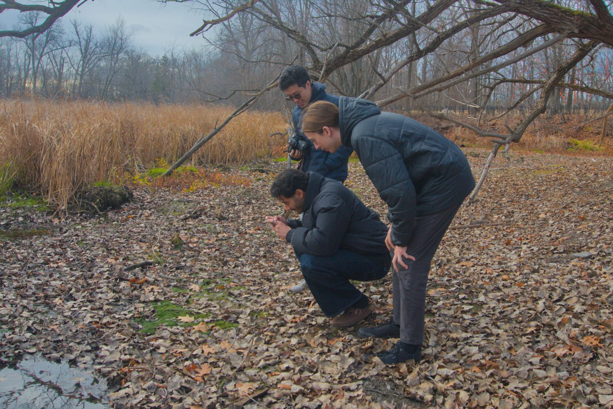
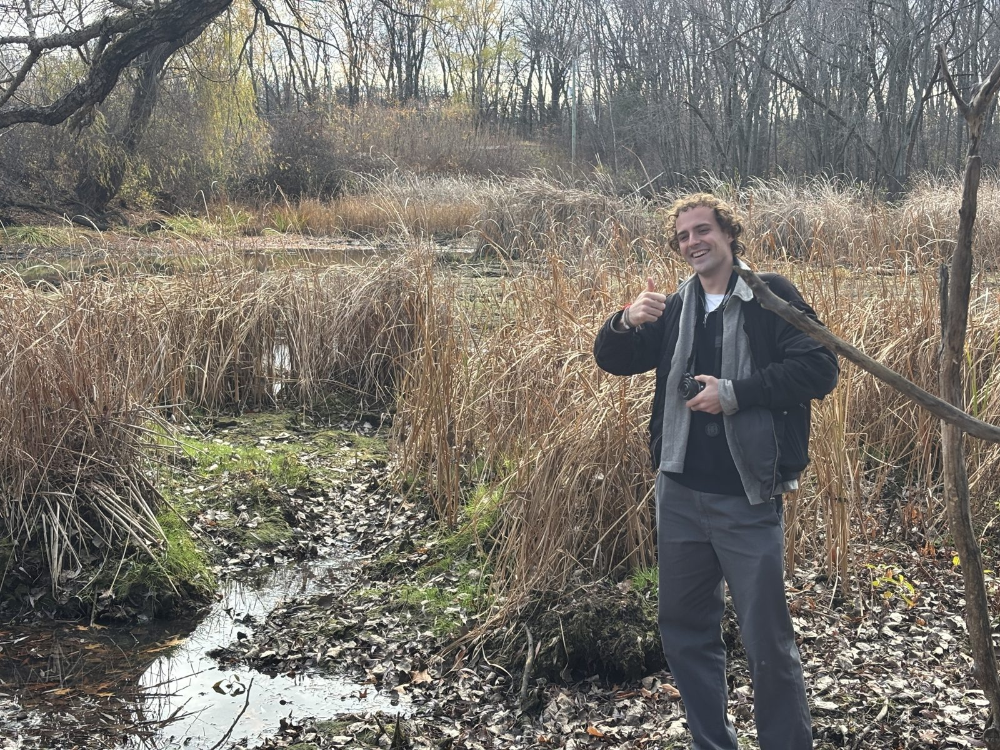
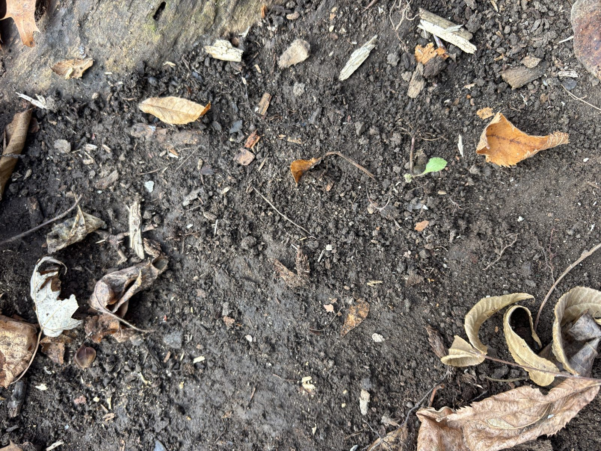
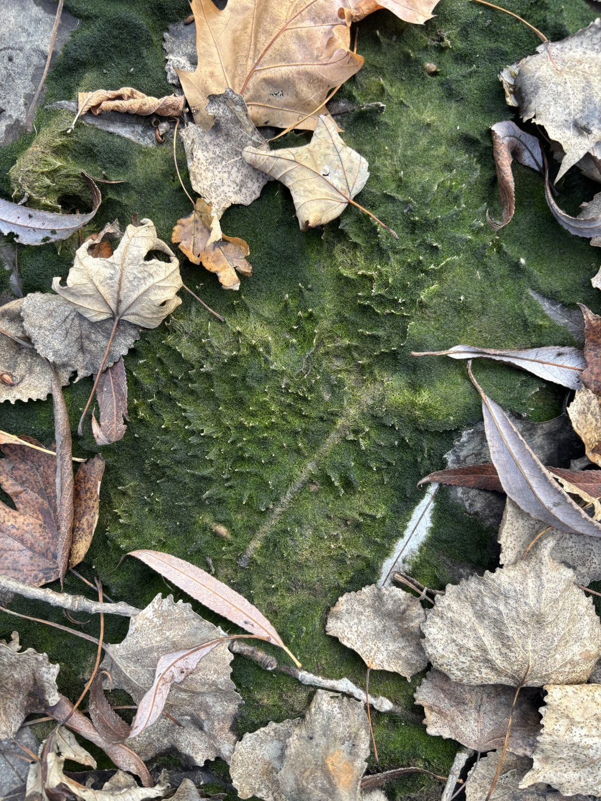
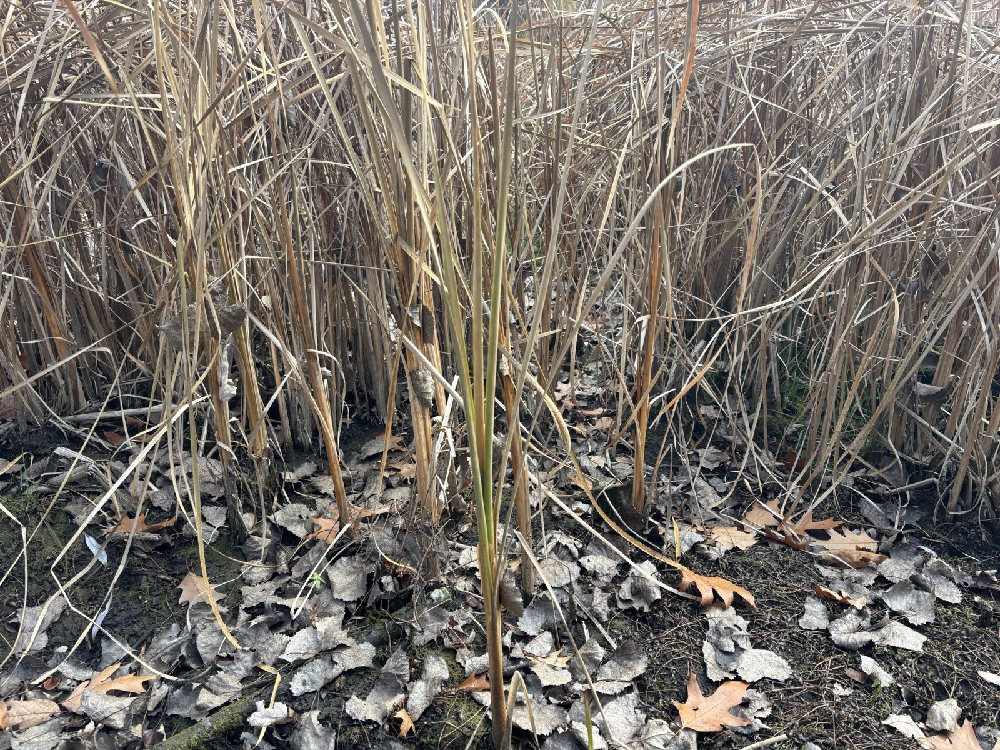
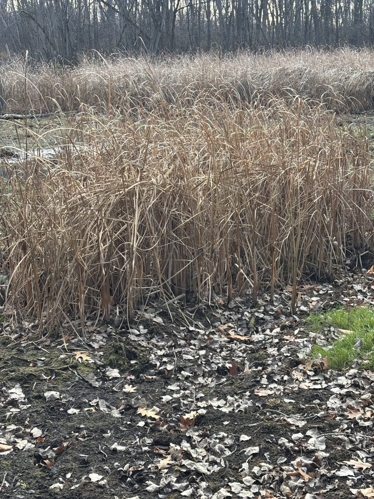
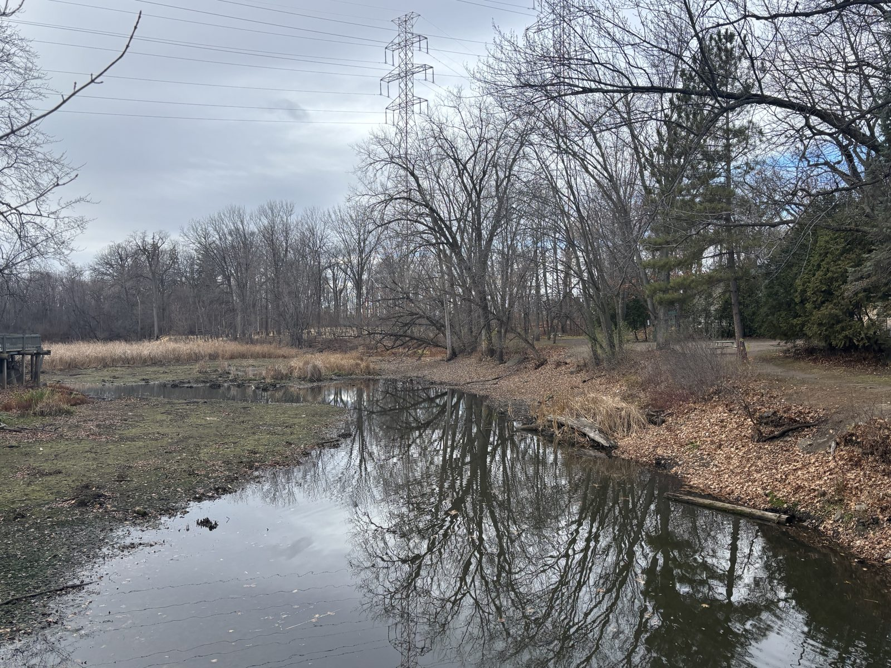
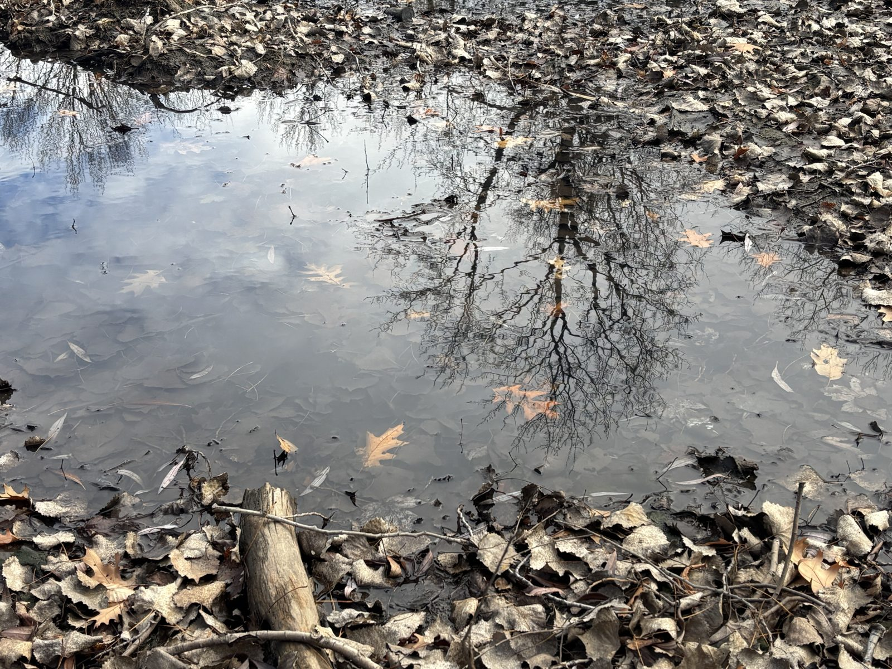
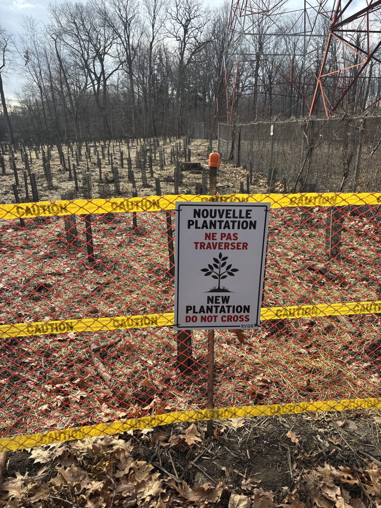
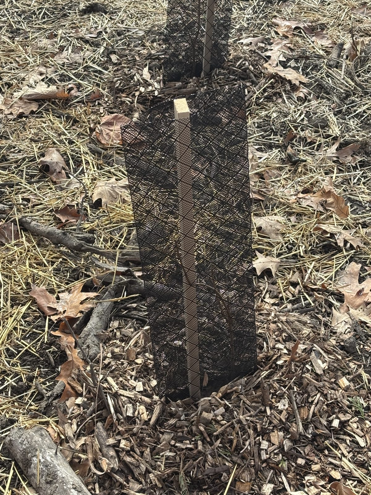

# UdeM AI in nature

Photos from the team's field outing during NASA Space Apps 2026: a pond edge with wet, low ground, a cattail marsh, bare soil and a fenced young plantation. Low wet pockets like this pond edge are the zones Taupin flags for scouting. Metadata, including location, was removed from every file.

| | |
|---|---|
|  |  |
| Scouting the pond edge | In the marsh |
|  |  |
| Bare soil | Moss on wet ground |
|  |  |
| Cattail stems | Cattail stand |
|  |  |
| The pond | Standing water |
|  |  |
| New plantation, do not cross | Tree guard |
